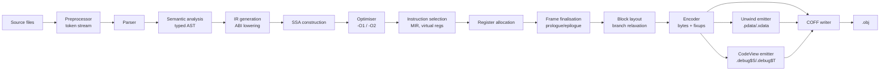

# 02 — Architecture

## 1. Pipeline

`ncc` is a single executable. One invocation compiles one or more translation units sequentially; the driver parallelises across TUs by spawning processes (the `/MP` model), so the compiler core can stay single-threaded and deterministic.

The front end works on a whole translation unit. Everything from IR generation onward works one function at a time, in definition order, and releases that function's memory when its machine code, unwind data and debug records have been handed to the object writer. This bounds peak memory to "AST of the TU plus one function's IR and MIR", which matters for `windows.h`-sized inputs. The exceptions are inlining (needs callee IR, so callees are kept in IR form until the call graph says they are no longer needed) and internal-linkage functions that are never referenced (dropped before IR generation).

At `-O0` the optimiser is skipped, SSA construction is skipped (locals stay in stack slots, which is also what makes `-O0` debugging trivially correct), and a fast local register allocator replaces linear scan.

## 2. Components

| Component | Directory | Responsibility |
|-----------|-----------|----------------|
| core | `src/core` | Arenas, vectors, hash maps, string interning, bigint, diagnostics, source manager, file I/O, hashing (SHA-256 for CodeView checksums) |
| lex / pp | `src/pp` | Lexer, macro expansion, conditional inclusion, `#embed`, include search, pragma dispatch |
| parse | `src/parse` | Recursive-descent parser producing untyped syntax nodes with declarations resolved through the scope stack |
| sema | `src/sema` | Types, declarations, conversions, constraint checking, constant evaluation, layout, attributes |
| irgen | `src/irgen` | AST → IR, including calling-convention lowering |
| ir | `src/ir` | IR data structures, builder, verifier, printer/parser (textual IR for tests) |
| opt | `src/opt` | Analyses (dominators, loops, alias, call graph) and transformation passes |
| arm64 | `src/target/arm64` | Instruction selection, MIR, register allocation, frame lowering, peepholes, encoder, `-S` printer |
| unwind | `src/target/arm64/unwind` | Unwind-code generation, packing, verifier |
| coff | `src/obj/coff` | Section/symbol/relocation model and serialiser, `.drectve`, bigobj |
| codeview | `src/debug/codeview` | Type table and symbol stream emission |
| driver | `src/driver` | Command line, environment discovery, TU scheduling, `link.exe` invocation |
| headers | `include/` | Compiler-provided headers (`stdarg.h`, `stdatomic.h`, `stdbit.h`, overlays) |
| runtime | `runtime/` | `libncrt.lib` sources |
| tests | `tests/` | Test runner and suites ([14-testing-strategy.md](14-testing-strategy.md)) |

Dependencies point strictly left to right in the pipeline, and `core` is below everything. In particular the back end never sees the AST, and the IR never refers to sema types; what IR generation needs from layout it copies into the IR (sizes, alignments, ABI classification).

## 3. Core library conventions

The core library is the price of D-01 and is designed before anything else, because every later component's code quality depends on it.

**Memory.** All long-lived allocation is arena-based. There are three lifetimes: the session arena (interned strings, file contents, the type table), the TU arena (AST, symbols), and the function arena (IR, MIR, liveness, scratch), reset after each function. Individual `free` is not used in the compiler proper. Arenas hand out memory in 64 KiB chunks from `VirtualAlloc`/`mmap` and support checkpoints for speculative work (e.g. tentative parsing of a type name).

**References are handles.** IR values, blocks, MIR instructions and virtual registers are 32-bit indices into per-function arrays, not pointers. This halves memory traffic, makes side tables (`vec` indexed by value id) trivial, and makes serialisation and printing deterministic. AST nodes may be pointers since the AST is immutable after sema.

**Containers.** `VEC(T)` is a macro-generated typed growable array; `HMAP(K,V)` is an open-addressing map with Robin Hood probing, generated per key/value pair via an include-with-parameters pattern (`#define HMAP_K ... #include "core/hmap.inc"`). Iteration order of hash maps must never influence output; anything that is emitted is sorted or kept in insertion order.

**Strings.** All identifiers, file names and section names are interned into `Sym` handles. Comparison is integer comparison.

**Errors.** Diagnostics are collected with source ranges and a stable diagnostic id (`NC1234`), rendered in MSVC format (`file(line,col): error NC1234: ...`) so the VS error list and MSBuild parse them. Internal invariants use `nc_assert`, which is fatal and prints the compiler stack (we generate our own `.pdata`, so the stack walk doubles as a self-test).

**Tables as X-macros.** Instruction encodings, IR opcodes, intrinsic signatures, diagnostics, CodeView record kinds and keywords are each a single `*.def` file expanded in multiple places. This replaces TableGen (D-07).

## 4. Determinism and reproducibility

Output must be a pure function of the input bytes, the command line and the compiler binary. Concretely: the COFF `TimeDateStamp` is zero or a content hash (as with MSVC `/Brepro`); no hash table is iterated for output; symbol, section and type-record order follow source order; temporary names derive from per-function counters; absolute paths in debug info can be remapped (`/pathmap:`); `__DATE__`/`__TIME__` honour `SOURCE_DATE_EPOCH`. The bootstrap check (stage 2 objects byte-identical to stage 3) enforces this continuously.

## 5. Performance budget

Design targets, measured on a 16-core Arm64 laptop class machine, single TU, warm cache:

| Workload | Target |
|----------|--------|
| Preprocess + parse + sema of `#include <windows.h>` (empty TU) | ≤ 150 ms |
| `-O0` end to end, 10k-line TU | ≤ 300 ms |
| `-O2` end to end, 10k-line TU | ≤ 1.5 s |
| Peak memory, `-O2`, `sqlite3.c` amalgamation | ≤ 1 GiB |

The `windows.h` number is the one that shapes design: it drives the multiple-include optimisation in the preprocessor, a fast keyword/identifier hash, lazy creation of declarations for never-referenced macros, and avoiding per-token heap allocation. Precompiled headers are deliberately not in v1; if the budget is missed, PCH (serialised TU arena) is the escape hatch, and the handle-based design makes it feasible.

## 6. Error recovery and robustness

The front end recovers from syntax errors at statement and declaration boundaries and continues to report errors; the back end is never run on a TU with errors. Fuzzing (§14) targets two properties: no crash on any input, and no IR verifier failure on any accepted input. The IR verifier runs after every pass in debug builds and after IR generation and before instruction selection in release builds.

## Open items from this document

Whether to add in-process multi-threaded function codegen later (the function-at-a-time design allows it; v1 is single-threaded per process).
