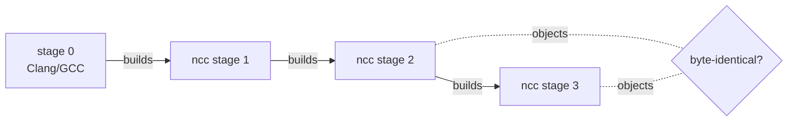

# 13 — Self-hosting and bootstrap

## 1. Implementation dialect

`ncc` is written in a restricted C23 dialect called **NC-Boot**. Its purpose is to be compilable by every stage-0 compiler we support and by `ncc` itself from the earliest phase in which it can self-host, so that self-hosting is not gated on the last C23 feature landing.

**Allowed:** all of C17; C23 `bool`/`true`/`false` keywords, `nullptr`, `static_assert` (one- and two-argument), `alignas`/`alignof`, `thread_local` (not used in the compiler, but allowed in `libncrt`), `typeof`, standard attributes (`[[nodiscard]]`, `[[maybe_unused]]`, `[[fallthrough]]`, `[[noreturn]]`, `[[deprecated]]`), enumerations with a fixed underlying type, binary literals, digit separators, empty initialisers `{}`, labels before declarations, `#elifdef`/`#elifndef`, `__VA_OPT__`.

**Not allowed in compiler sources:** `_BitInt`, `auto` type inference, VLAs and `alloca` (stack use must be bounded; recursion depth in the parser is explicitly limited), `#embed`, `_Complex`, `_Float16`, `[[unsequenced]]`/`[[reproducible]]`, any compiler extension (`__attribute__`, `__declspec`, statement expressions, `__builtin_*` except through `core/compiler.h` shims), and any platform header other than through the thin OS layer in `core/os_win32.c` / `core/os_posix.c`.

**Portable enumerators.** An enumerator of an enum without a fixed underlying type must be representable in `int`. Under the MSVC ABI such an enum is always `int`, while the System V ABIs widen it, so `0xFFFFFFFFu` is `-1` on Windows and unsigned on Linux. No Linux build sees the difference; the `windows-arm64` job found it on its first run of milestone 1.1. A larger constant takes a fixed underlying type (`enum : u32 { ... }`, as the section characteristics in `obj/coff/coff.h` do) or is a `const` object.

Supported stage-0 compilers: **Clang ≥ 18** (including the `clang` shipped with VS 2026's Clang tools) and **GCC ≥ 13**, both in `-std=c2x` mode. Phase 0 is built and tested with exactly these (Clang 18.1, GCC 13.3). They accept everything listed above; the one C23 feature they lack between them is `constexpr` objects (Clang gained it in 19), which is therefore not allowed in compiler sources until the stage-0 minimum is raised. Binary literals and digit separators are allowed by the dialect but avoided for now because Clang 18 warns on binary literals under `-pedantic`. MSVC `cl` is not a supported stage-0: its C23 support is incomplete (no `constexpr`, partial attributes), and accommodating it would push NC-Boot back to C17. A `ci/nc-boot-check` job compiles the tree with each supported stage-0 under `-std=c23 -pedantic-errors -Werror` and, once available, with `ncc /std:c23 /permissive- /WX`, so dialect violations are caught immediately.

## 2. Bootstrap stages

Stage 1 is `ncc` built by a foreign compiler; it runs on whatever host built it (Linux x64/arm64 during early development, Windows ARM64 or x64 later). Stage 1 is a cross-compiler when the host is not Windows ARM64: it emits ARM64 COFF objects regardless of where it runs.

Stage 2 is `ncc` compiled by stage 1, linked with `link.exe` (or `lld-link` in Linux CI) against the UCRT: it is the first native Windows ARM64 `ncc.exe`. Stage 3 is `ncc` compiled by stage 2. The stage 2 and stage 3 *object files* must be byte-identical (not the executables, whose PE timestamps and PDB GUIDs are `link.exe`'s business unless `/Brepro` is passed to the linker too, in which case the executables must match as well). This is the strongest available end-to-end test of the compiler: stage 2 is a large, real C program compiled by an `ncc` that was itself compiled by `ncc`, and any miscompilation in stage 1's output tends to show up as a stage-2/stage-3 difference or a crash.

The bootstrap runs on every merge to the main branch at `-O0` and `-O2`, with debug info on and off.

## 3. Host portability

The compiler core is host-independent C; the only host-specific code is `core/os_*.c` (file mapping, directory enumeration, process spawning for the driver, high-resolution timing, file identity for `#pragma once`). Running on Linux is a first-class mode for development and CI (fast, cheap runners), and on Windows x64 as a cross-compiler, as well as natively on Windows ARM64. Output must be identical across hosts for the same inputs (no host `strtod`, no host locale, no host `qsort` with unstable ordering, no reliance on host `long` size since Linux is LP64 and Windows LLP64: the compiler uses `int64_t`/`uint64_t` and `size_t` explicitly, and NC-Boot forbids `long` in compiler sources).

## 4. Seed binaries and releases

Once stage 2 is stable, each release publishes `ncc.exe` (ARM64 and x64 cross builds) as a seed, together with its SHA-256 and the stage-0 compiler versions used. A fresh checkout can then bootstrap from the previous release instead of from Clang/GCC, and the CI also builds from Clang to ensure the stage-0 path stays healthy (protecting against a "trusting trust"-style dependency on our own binaries, and against NC-Boot drift).

## 5. Consequences of self-hosting for the design

The compiler is its own largest test case, which pushes several design choices: it must compile itself fast at `-O0` (the inner development loop is "edit, build with stage 2, test"), so `-O0` compile speed is a first-class requirement; the core library's macro-generated containers must produce good code under our own optimiser, which makes them an `-O2` benchmark; and the compiler does not include `windows.h` at all: `core/os_win32.c` declares the few dozen `kernel32` functions it needs itself. The UCRT headers are still required (for `stdio.h`, `stdlib.h`, `string.h`), so the subset of the compatibility layer the UCRT needs is a prerequisite for stage 2, but the much larger `windows.h` surface is not. That lets self-hosting arrive before full `windows.h` support ([15-roadmap.md](15-roadmap.md)).

## Open items from this document

None beyond those in [16-open-questions.md](16-open-questions.md).
